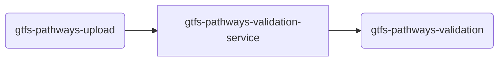

# TDEI-python-gtfs-pathways-validation

[](https://github.com/TaskarCenterAtUW/TDEI-python-gtfs-pathways-validation/actions/workflows/unit_tests.yaml)

[](https://pypi.org/project/python-ms-core/)

## Introduction 
Service to Validate the GTFS pathways file that is uploaded. At the moment, the service does the following:
- Listens to the topic which is mentioned in `.env` file for any new message (that is triggered when a file is uploaded), example  `UPLOAD_TOPIC=gtfs-pathways-upload` 
- Consumes the message and perform following checks - 
  - Download the file locally 
  - File location is in the message `data.meta.file_upload_path`, reference see this file [msg-gtfs-pathways-upload.json](./src/assets/msg-gtfs-pathways-upload.json)
  - Runs [MobilityData's GTFS validator](https://github.com/MobilityData/gtfs-validator) on the file, locally
  - Runs TDEI's own pathways checks ([src/custom_checks.py](./src/custom_checks.py)) on the same file
  - Decides whether the file passes using the rules in [src/pathways_config.py](./src/pathways_config.py), which apply to both
  - Measures how complete and step-free the feed's stations are ([src/pathways_metrics.py](./src/pathways_metrics.py))
  - Uploads a report of every problem found and the metrics (`report.json` and `report.html`, zipped with MobilityData's own reports) next to the uploaded file
  - Adds `success`, `message`, `report_url` and `report_summary` to the response message
- Publishes the result to the topic mentioned in `.env` file, example `VALIDATION_TOPIC=gtfs-pathways-validation`

## Getting Started
The project is built on Python with FastAPI framework. All the regular nuances for a Python project are valid for this.

### System requirements
| Software   | Version |
|------------|---------|
| Python     | 3.10.x  |
| Java       | 17 or later (for MobilityData's GTFS validator) |

MobilityData's validator is a Java program. Download the pinned version (to `lib/`, which is ignored by git) with:
```
scripts/download-gtfs-validator.sh lib
```
The Docker image does this itself. To change the version, set `GTFS_VALIDATOR_VERSION` and add its checksum to the script.


### Connectivity to cloud
- Connecting this to cloud will need the following in the `.env` file

```bash
REQUEST_TOPIC=xxx
RESPONSE_TOPIC=xxx
REQUEST_SUBSCRIPTION=xxx
QUEUECONNECTION=xxxx
STORAGECONNECTION=xxxx
MAX_CONCURRENT_MESSAGES=xxx
```

Optional settings for MobilityData's validator:
```bash
GTFS_VALIDATOR_JAR=lib/gtfs-validator-cli.jar  # where the validator is
GTFS_VALIDATOR_COUNTRY_CODE=us                 # for country-specific rules, e.g. phone numbers
GTFS_VALIDATOR_TIMEOUT=900                     # seconds
JAVA_PATH=java
```

The application connect with the `STORAGECONNECTION` string provided in `.env` file to download the uploaded file and upload its validation report.
`QUEUECONNECTION` is not being used in this application but this is the main requirement for `python-ms-core` package

`MAX_CONCURRENT_MESSAGES` - Maximum number of concurrent messages that the app can process. Defaults to 2

### How to Setup and Build
Follow the steps to install the node packages required for both building and running the application

1. Setup virtual environment
    ```
    python3.10 -m venv .venv
    source .venv/bin/activate
    ```

2. Install the dependencies. Run the following command in terminal on the same directory as `requirements.txt`
    ```
    # Installing requirements
    pip install -r requirements.txt
    ```
### How to Run the Server/APIs   

1. The http server by default starts with `8000` port
2. Run server
    ```
    uvicorn src.main:app --reload
    ```
3. By default `get` call on `localhost:8000/health` gives a sample response
4. Other routes include a `ping` with get and post. Make `get` or `post` request to `http://localhost:8000/health/ping`
5. Once the server starts, it will start to listening the subscriber(`UPLOAD_SUBSCRIPTION` should be in env file)

### How to Setup and run the Tests

Make sure you have setup the project properly before running the tests, see above for `How to Setup and Build`.

#### How to run test harness
1. Add the new set of test inside `tests/test_harness/tests.json` file like -
    ```
    {
     "Name": "Test Name",
     "Input_file": "test_files/pathways_test_case1.json", // Input file path which you want to provide to the test
     "Result": true/false // Defining the test output 
     }
    ```
2. Test Harness would require the valid `.env` file.
3. To run the test harness `python tests/test_harness/run_tests.py` 
#### How to run unit test cases
1. `.env` file is not required for Unit test cases.
2. To run the unit test cases
   1. `python test_report.py`
   2. Above command will run all test cases and generate the html report, in `reports` folder at the root level.
3. To run the coverage
   1. `coverage run --source=src -m unittest discover -s tests/unit_tests`
   2. Above command will run all the unit test cases.
   3. To generate the coverage report in console
      1. `coverage report`
      2. Above command will generate the code coverage report in terminal. 
   4. To generate the coverage report in html.
      1. `coverage html`
      2. Above command will generate the html report, and generated html would be in `htmlcov` directory at the root level.
   5. _NOTE :_ To run the `html` or `report` coverage, 3.i) command is mandatory

#### How to run integration test cases
1. `.env` file is required for Unit test cases.
2. To run the integration test cases, run the below command
   1. `python test_integration.py`
   2. Above command will run all integration test cases and generate the html report, in `reports` folder at the root level.


### Messaging

This microservice deals with two topics/queues. 
- upload queue from gtfs-pathways-upload
- validation queue from gtfs-pathways-validation



#### Incoming Message

```json
{
    "messageId": "c8c76e89f30944d2b2abd2491bd95337",
    "messageType": "workflow_identifier",
    "data": {
      "file_upload_path": "https://tdeisamplestorage.blob.core.windows.net/gtfsflex/tests/success_1_all_attrs.zip",
      "user_id": "c59d29b6-a063-4249-943f-d320d15ac9ab",
      "tdei_project_group_id": "0b41ebc5-350c-42d3-90af-3af4ad3628fb"
    }
  }

```

#### Outgoing Message
```json
{
    "messageId": "c8c76e89f30944d2b2abd2491bd95337",
    "messageType": "workflow_identifier",
    "data": {
      "file_upload_path": "https://tdeisamplestorage.blob.core.windows.net/osw/test_upload/valid.zip",
      "user_id": "c59d29b6-a063-4249-943f-d320d15ac9ab",
      "tdei_project_group_id": "0b41ebc5-350c-42d3-90af-3af4ad3628fb",
      "success": true,
      "message": "",
      "report_url": "https://tdeisamplestorage.blob.core.windows.net/osw/test_upload/valid-validation-report-1a2b3c4d.zip",
      "report_summary": {
        "valid": true,
        "feed": "valid.zip",
        "validatedAt": "2026-10-22T21:40:00+00:00",
        "gtfsValidatorVersion": "8.0.1",
        "codesByOutcome": {"fails_upload": 0, "downgraded_to_warning": 1, "warning": 3, "info": 2},
        "metrics": {
          "completeness": {
            "stationsWithPathways": {"count": 4, "total": 5, "percent": 80.0},
            "stopsWithLevelId": {"count": 120, "total": 120, "percent": 100.0},
            "stopsWithWheelchairBoarding": {"count": 30, "total": 42, "percent": 71.4},
            "pathwaysWithLength": {"count": 150, "total": 180, "percent": 83.3},
            "pathwaysWithTraversalTime": {"count": 20, "total": 180, "percent": 11.1}
          },
          "connectivity": {
            "platformsStepFree": {"count": 11, "total": 12, "percent": 91.7},
            "entrancesReachingPlatformStepFree": {"count": 9, "total": 14, "percent": 64.3},
            "stationsStepFree": {"count": 3, "total": 4, "percent": 75.0}
          }
        }
      }
    }
  }

```

Every error fails an upload, from MobilityData's validator or TDEI's own checks, except those
[pathways_config.py](./src/pathways_config.py) downgrades to warnings. A feed that can't be read always fails.

`report_summary.metrics` measures the feed's stations; it's `null` if they couldn't be measured. Except for
`stationsWithPathways`, the metrics count within stations that have pathways. "Step-free" means using only
walkways, elevators, fare gates and exit gates, following pathway direction.

`message` lists the errors that failed the upload, as JSON. `report_url` is `null` if the report couldn't be uploaded;
the result doesn't depend on it.

### Validation report

The report zip holds:
- `report.json`: `summary` (as in `report_summary`) and `notices`, every problem found, worst first. Each notice is in
  MobilityData's format (`code`, `severity`, `totalNotices`, `sampleNotices`), plus `source` (`mobilitydata` or `tdei`)
  and `outcome`: `fails_upload`, `downgraded_to_warning` (an error [pathways_config.py](./src/pathways_config.py)
  accepts), `warning` or `info`. Notices keep up to 1,000 samples each, as MobilityData's do. TDEI's samples also
  have a `defectId` that stays the same while the problem does, e.g. `tdei_stairs_same_level:p1`.
- `report.html`: the same, to read in a browser, with the metrics.
- `mobilitydata/`: MobilityData's own `report.json`, `report.html` and `system_errors.json`.
